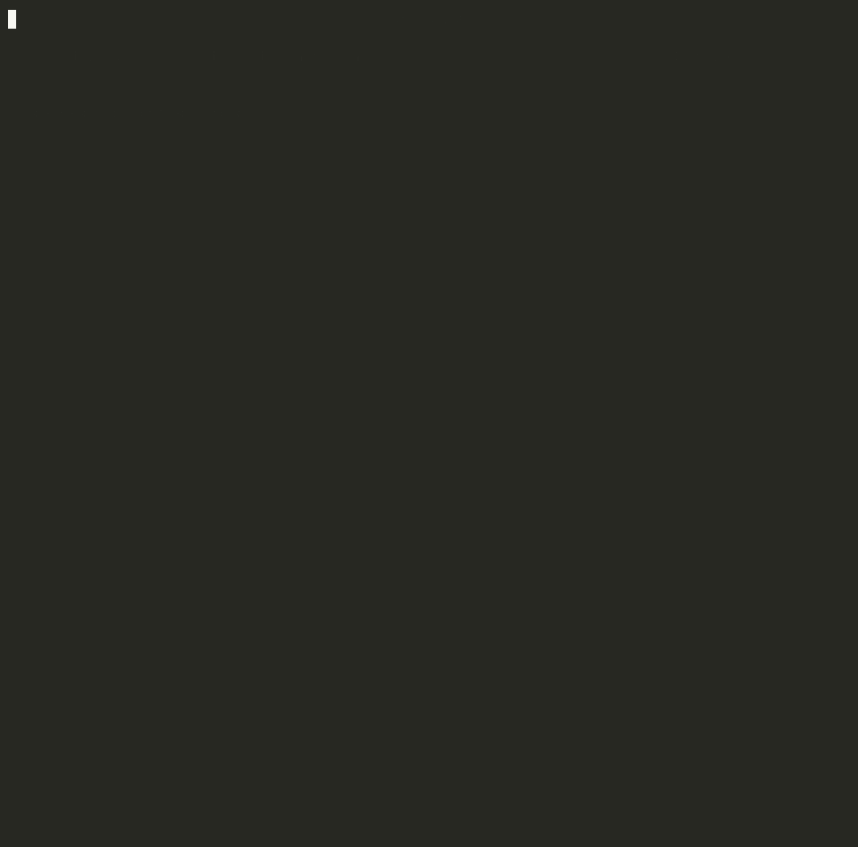

# whotalks

**Who does your computer talk to?** whotalks watches every outbound connection for one minute, then tells you which companies were on the other end, which apps were talking to them, and gives the whole thing a privacy grade.

```bash
uvx whotalks
```

<p align="center"></p>

<sub>The demo replays a typical laptop's minute (Chrome with a news site open, Slack, Spotify, VS Code, iCloud) so it looks the same every time. The company lookups in it are real. Run it yourself to see your own.</sub>

Most people have no idea that leaving a few apps open means talking to a hundred-plus servers a minute. whotalks makes that visible without installing a kernel extension, a firewall, or anything that needs root.

## What you get

- **Every server**, grouped by the **company** that runs it: Amazon, Google, Cloudflare, Meta, Microsoft, Apple…
- **Which app** made each connection, using the names you'd recognise ("Google Chrome", not "Google Chrome Helper (Renderer)"; "iCloud", not `cloudd`).
- **Ad and tracking networks** called out in red: Criteo, Taboola, Outbrain, The Trade Desk, PubMatic, Magnite, Xandr, Quantcast and others that run their own networks.
- A **privacy grade**: A means no dedicated ad or tracking networks, F means six or more.
- A share line: *"My laptop talked to 124 servers run by 20 companies in one minute (privacy grade: F)."*

## How it works

1. **Watch.** Twice a second, whotalks asks the OS for every open TCP connection and every connected UDP socket (that's how QUIC and HTTP/3 show up), keeps the ones going to public internet addresses, and notes which process owns each one. It uses [psutil](https://github.com/giampaolo/psutil), so it works the same on macOS, Linux and Windows.
2. **Look up the owner.** Every IP address belongs to a network (an ASN) registered to some organisation. whotalks uses the public-domain [iptoasn.com](https://iptoasn.com) database, downloaded once (~11 MB) and cached for 30 days, then maps networks to companies with a hand-checked list.
3. **Refine with names.** Reverse DNS fills gaps (an AWS address that answers to `*.github.com` is GitHub). On Windows, it also reads the DNS cache (`ipconfig /displaydns`) to see the actual names your machine looked up.

## Honest limits

- **The IP tells you the landlord, not always the tenant.** A server on Amazon (AWS) or Cloudflare could belong to any of their customers. That's why the report shows which app made each connection, and labels clouds and CDNs as such.
- **Google and Meta ads look like Google and Meta.** Their ad servers share networks with everything else they run, so whotalks can't count them as trackers. The grade only counts companies whose whole business is ads or tracking.
- **Very short connections can slip through.** Anything opened and closed in under half a second may be missed. Use `--interval 0.2` to look more often.
- **On macOS, other users' and some system processes are hidden** from a normal user. whotalks tells you how many, and `sudo whotalks` includes them.

## Options

```
whotalks                 # watch for 60 seconds
whotalks -s 300          # watch for 5 minutes (Ctrl-C to stop early and still get the report)
whotalks --all           # list every company, not just the top 12
whotalks --json          # everything, machine-readable
whotalks --no-rdns       # skip reverse-DNS lookups
whotalks --offline       # don't download the owner database; show apps and IPs only
whotalks --refresh-db    # re-download the owner database now
```

## Privacy

whotalks only reads connection tables from your OS. It sends nothing about you anywhere. The only network traffic it makes itself is the one-time database download from iptoasn.com and the reverse-DNS lookups (which go to your own DNS resolver, and which you can turn off with `--no-rdns`).

## Install

```bash
uvx whotalks          # run without installing
pipx install whotalks # or install it
```

Requires Python 3.9+. Depends on `rich` and `psutil`.

## License

MIT. IP-to-ASN data from [iptoasn.com](https://iptoasn.com), public domain (PDDL v1.0).
